


 

## 🛰️ Mission Briefing

I'm **Yokshith**, a Computer Science undergraduate at **Amrita Vishwa Vidyapeetham** (class of 2027) who builds AI products end to end: multi-agent systems, LLM and RAG apps, computer-vision models that run at the edge, robotics simulations, and local-first desktop apps in Rust.

I like problems where the AI has to *do* something in the real world: reroute a supply chain, match one factory's waste to another factory's input, recall what was promised in a meeting, or steer a quadruped through a room it has never seen.

**What I bring to a team**

- **Multi-agent architecture.** I've shipped a 6-agent Fetch.ai system, an 8-agent MCP platform with 14 tools, and AgentArena, a harness that benchmarks and fault-injects agents.
- **Full-stack delivery.** I take products from schema to deployment: Next.js frontends, Postgres/pgvector backends, payments, CI/CD, and live Vercel deploys.
- **Engineering discipline.** I work in ticketed pull requests with CI and code review. In November 2026 alone I made **319 commits** and opened **30 PRs** across 4 repositories.
- **Range across the stack.** I've worked from YOLOv8 models on a Raspberry Pi 4, to SLAM in CoppeliaSim, to a Rust core behind a Tauri desktop app.

## 🏆 Hackathon Wins

<a href="https://github.com/yokshith09/SupplyShock-FETCHATHON-3.0"></a>

<a href="https://agentverse.ai/agents/details/agent1qgt7x0cakv0htfapv9yecj8mqw28jsyramh03aqztfquzlavcadc7nczfdz/profile">SupplyShock on Agentverse</a> ·
<a href="https://sym-bio-forge.vercel.app/">SymBioForge live demo</a>

## 🪐 Featured Projects

<a href="https://github.com/yokshith09/PLUTO-VOICE">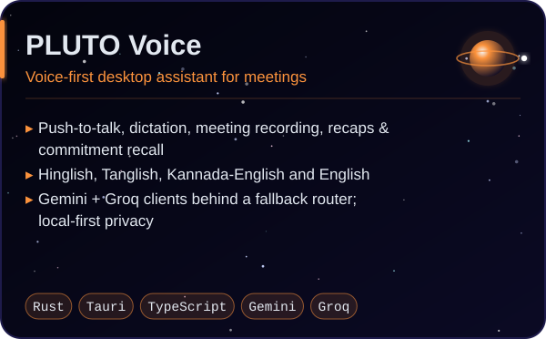</a>
<a href="https://github.com/yokshith09/PLUTO-DESKTOP-PRODUCTIVITY-COMPANION">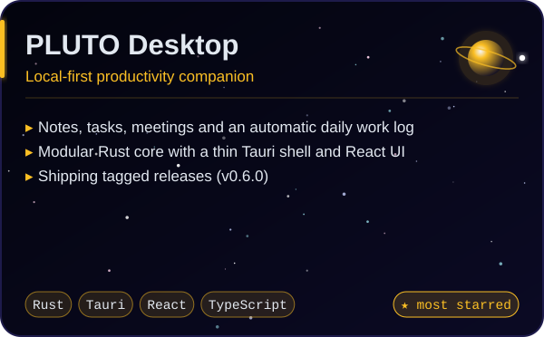</a>
<a href="https://github.com/yokshith09/AgentArena">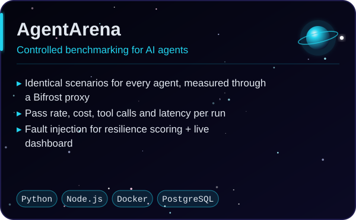</a>
<a href="https://github.com/yokshith09/Autonomous-Quadruped-SLAM-Navigation-Perception">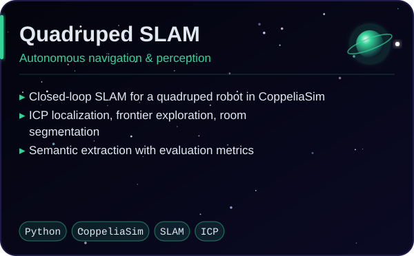</a>
<a href="https://github.com/yokshith09/DRIP---AI-3D-VIRTUAL-TRY-ON-WEB">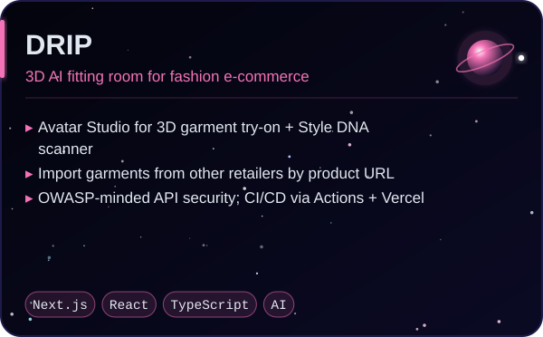</a>
<a href="https://github.com/yokshith09/WEARSHARE-APP">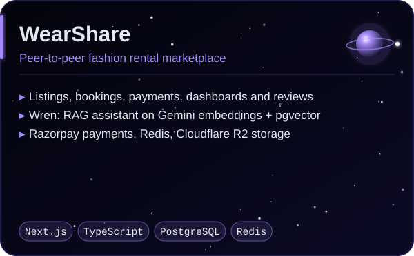</a>

<b>🔭 More from the observatory</b>

 

| Project | What it is | Stack |
| --- | --- | --- |
| [WeedPlucker](https://github.com/yokshith09/WeedPlucker-YOLOv8-Intelligent-Weed-Detection-Robotic-Plucking-System) | Crop/weed instance segmentation for robotic plucking, exported to ONNX for real-time inference on a Raspberry Pi 4 | YOLOv8 · PyTorch · ONNX Runtime |
| [Diabetic Retinopathy Detection](https://github.com/yokshith09/Advanced-Diabetic-Retinopathy-Detection) | Detection and severity grading from retinal fundus images across multiple architectures | Python · Deep Learning |
| [Secured Travel Itinerary](https://github.com/yokshith09/SECURED-TRAVEL-ITERNARY-) | NIST SP 800-63-2 aligned app with password + email-OTP MFA and role-based access | Flask · MongoDB |
| [OpsMind (GCP)](https://github.com/yokshith09/OpsMind--GCP) | Cloud health, log monitoring and cost-optimization dashboard | Python · GCP |
| [PasswordPal](https://github.com/yokshith09/PasswordPal_Frontend) | Team project: local-first password vault with encrypted sync | Tauri · Rust · React |
| [Fake Currency Detection](https://github.com/yokshith09/FAKE-CURRENCY-DETECTION-USING-MACHINE-LEARNING-AND-IMAGE-PROCESSING-TECHNIQUES) | Counterfeit-note detection with Local Binary Patterns + Random Forest | Python · OpenCV · scikit-learn |
| [COLLAB-SPACE](https://github.com/yokshith09/COLLAB-SPACE) | Collaborative workspace web app | TypeScript |
| [HireNudge](https://github.com/yokshith09/HireNudge---MMP---AI-JOB-MATCHER-) | AI job-matcher MVP | TypeScript |

## 🌌 Tech Constellations

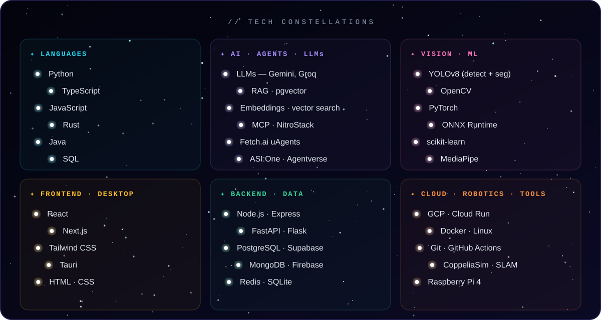

  

 

## 🚀 Flight Log

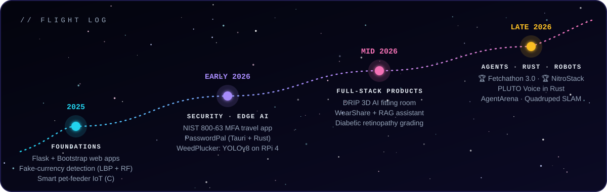

## 📡 Telemetry

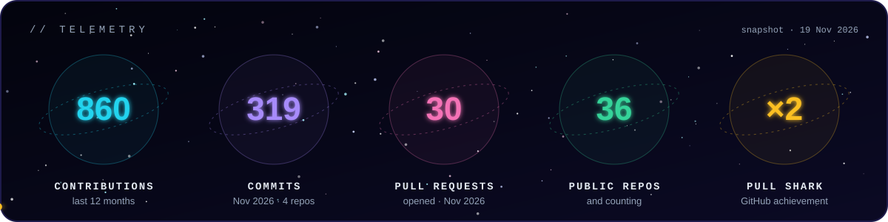

  

<picture>
  <source media="(prefers-color-scheme: dark)" srcset="https://raw.githubusercontent.com/yokshith09/yokshith09/output/github-snake-dark.svg"/>
  <source media="(prefers-color-scheme: light)" srcset="https://raw.githubusercontent.com/yokshith09/yokshith09/output/github-snake.svg"/>
  
</picture>

### 🎖️ Achievements

| | Achievement | Proof |
| :-: | --- | --- |
| 🏆 | **Hackathon win: Fetchathon 3.0** with SupplyShock | [repo](https://github.com/yokshith09/SupplyShock-FETCHATHON-3.0) |
| 🏆 | **Hackathon win: NitroStack Hackathon** with SymBioForge (team of 4) | [repo](https://github.com/yokshith09/SymBioforge-NitroStack-MCP) · [live](https://sym-bio-forge.vercel.app/) |
| 🦈 | **Pull Shark ×2**, a GitHub achievement for merged pull requests | [achievements](https://github.com/yokshith09?tab=achievements) |
| ⭐ | **Most-starred repo:** PLUTO Desktop Productivity Companion | [repo](https://github.com/yokshith09/PLUTO-DESKTOP-PRODUCTIVITY-COMPANION) |
| 🔥 | **860 contributions** in the last 12 months | [profile](https://github.com/yokshith09) |

## 📬 Open a Channel


 

